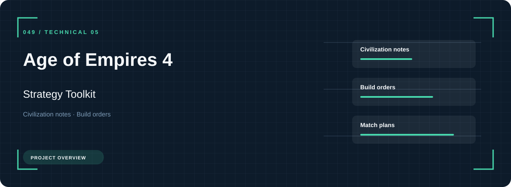
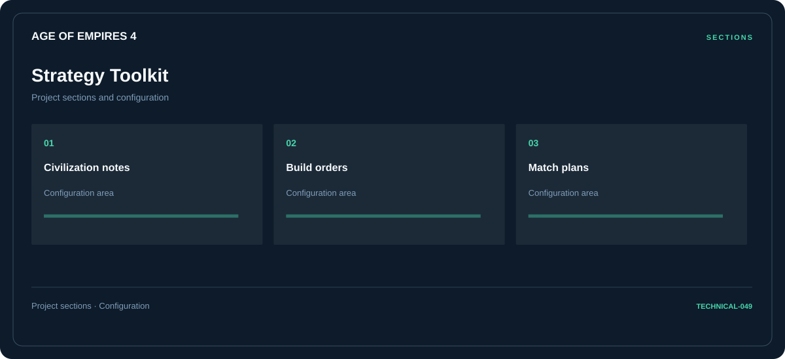

# 🎮 Age of Empires 4 Strategy Toolkit

**Civilization notes · Build orders · Match plans**

## ⚡ Features

Civilization notes, build orders, and match plans form the core of Age of Empires 4 Strategy Toolkit. Related configuration is grouped by task rather than collected in an undifferentiated list.

### ⚙️ Civilization notes

A dedicated section for civilization notes and the configuration details associated with that area.

### 🧩 Build orders

A dedicated section for build orders and the configuration details associated with that area.

### ⌨️ Match plans

Session and activity information grouped by the task or context it belongs to.

## 🖥️ Project navigation

## 📥 Download

The button and cover open the project's download page. Use the information supplied with the downloaded package for installation and release-specific requirements.

## 📚 Project documentation

- [Feature reference](docs/FEATURES.md)
- [Download information](docs/DOWNLOAD.md)
- [Project page](index.html)

---

Age of Empires 4 Strategy Toolkit · Program documentation and download information.
